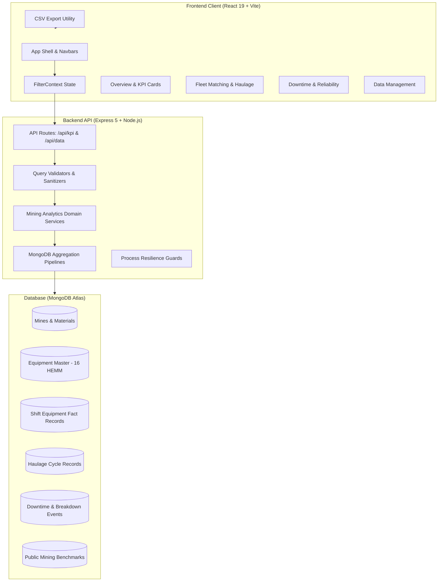

# Surface Mining Operations & Equipment Utilization Dashboard

> **Undergraduate B.Tech Project**  
> *Development of a Web-based Production, Fleet Utilization, and Operational Decision Support System for Surface Mining Operations*

[](https://nodejs.org/)
[](https://react.dev/)
[](https://vitejs.dev/)
[](https://www.mongodb.com/)
[](./UGP/backend/test)
[]()

---

## 1. Project Overview

The **Surface Mining Operations & Equipment Utilization Dashboard** is a full-stack engineering application designed for mining engineers, fleet dispatchers, and operations analysts. It provides real-time quantitative monitoring and historical diagnostics for heavy earthmoving machinery (HEMM), production attainment, haulage cycle kinematics, equipment reliability (MTBF/MTTR), and shovel–dumper fleet matching.

The application utilizes a **hybrid dataset approach**:
1. **Realistic Synthetic Telemetry**: Granular 21-day shift-level HEMM logs, 5-phase haulage cycles, and equipment breakdown records generated deterministically.
2. **Authentic Public Sector Benchmarks**: Verified reference production norms from **Coal India Limited (CIL)**, **Indian Bureau of Mines (IBM)**, and **Directorate General of Mines Safety (DGMS)**.

---

## 2. Key Analytical Modules

The dashboard is structured into **10 dedicated analytical modules** accessible via the top-level sticky sub-navigation bar:

```
┌────────────────────────────────────────────────────────────────────────────────────────┐
│                        SURFACE MINING DASHBOARD (APP SHELL)                           │
├────────────────────────────────────────────────────────────────────────────────────────┤
│ [Overview] [Production] [Equipment] [Downtime] [Haulage]                               │
│ [Shovel-Dumper Matching] [Material & Stripping] [Fuel & Cost] [Insights] [Data]        │
└────────────────────────────────────────────────────────────────────────────────────────┘
```

1. **Executive Operations Overview**:
   Consolidated high-level KPIs (Total Production, Plan Attainment, Mechanical Availability, Operating Utilization, Lost Downtime Hours, and Unit Cost per Tonne), daily production area curves, and a Pareto downtime root-cause widget.
2. **Production Performance Analysis**:
   Daily extraction actuals vs. budget targets, shift-wise variations (A, B, C), cumulative production trajectories, and material category partitioning (Mineral vs. Overburden).
3. **Equipment Fleet Performance & Availability**:
   Reconciled shift-hour breakdowns (Operating, Idle, Maintenance) and mining engineering availability metrics:
   $$\text{Mechanical Availability (MA)} = \frac{\text{Scheduled Hours} - \text{Maintenance Hours}}{\text{Scheduled Hours}} \times 100$$
   $$\text{Operating Utilization (OU)} = \frac{\text{Operating Hours}}{\text{Scheduled Hours}} \times 100$$
   $$\text{Use of Availability (UA)} = \frac{\text{Operating Hours}}{\text{Scheduled Hours} - \text{Maintenance Hours}} \times 100$$
4. **Downtime & Equipment Reliability (DGMS Standards)**:
   Segregation of Planned Maintenance (PM) vs. Unplanned Breakdowns vs. Operational Delays. Computes **Mean Time Between Failures (MTBF)** and **Mean Time To Repair (MTTR)** strictly using qualifying failure events.
5. **Haulage Cycle Kinematics**:
   Decomposition of 5 non-overlapping kinematic cycle phases:
   $$\text{Total Cycle Time } (T_c) = t_{\text{queue}} + t_{\text{load}} + t_{\text{haul}} + t_{\text{dump}} + t_{\text{return}}$$
   Surfaces bench bottleneck queue delay percentages and dumper hourly productivities ($t/\text{hr}$).
6. **Shovel–Dumper Fleet Matching**:
   Evaluates kinematic balance using the SME Match Factor (MF):
   $$\text{MF} = \frac{N_d \times t_l}{N_s \times T_c}$$
   Categorizes crews as *Balanced* ($0.85 \le \text{MF} \le 1.05$), *Under-Trucked* ($\text{MF} < 0.85$, excavator starved), or *Over-Trucked* ($\text{MF} > 1.05$, bench bunching), and estimates bucket loading pass counts ($N_p$).
7. **Material Stratum & Stripping Analysis**:
   Volumetric Stripping Ratio ($SR_v \text{ in m}^3/\text{t}$) and Gravimetric Stripping Ratio ($SR_m \text{ in t/t}$) with physical stratum properties (in-situ density $\rho$ and swell factors).
8. **Fuel Consumption & Operating Cost Efficiency**:
   Equipment-level specific diesel consumption ($\text{L/h}$, $\text{L/t}$), operating cost breakdown, and specific cost per extracted tonne ($\text{₹/t}$).
9. **Operational Insights & Bottleneck Detection**:
   Rule-based heuristic diagnostics that automatically flag equipment availability deficits, excessive haulage queuing, shovel starvation, and high fuel burn rates.
10. **Management & Master Data Explorer**:
    Tabbed CRUD data ledger for raw shift records (with multi-parameter pagination), HEMM fleet specifications, material catalog, and official public mining reference benchmarks.

---

## 3. Technology Stack

| Layer | Technologies | Key Role in Project |
| :--- | :--- | :--- |
| **Frontend** | React 19, Vite 8, React Router 7 | Single Page Application (SPA), component architecture, client-side routing. |
| **Visualizations** | Recharts 3.8 | Composable charts (Area, Bar, Line, Donut, Stacked, Custom Tooltips). |
| **State & Context** | React Context API | Centralized `FilterContext` managing date ranges, shifts, HEMM types, and view-level CSV exports. |
| **Styling** | Custom Glassmorphism CSS | Design system tokens, responsive CSS Grid layout, light/dark/system themes. |
| **Backend** | Node.js, Express 5 (ES Modules) | RESTful API, input validation, aggregation pipelines, error middleware. |
| **Database** | MongoDB Atlas, Mongoose 9 | Document storage, compound indexes, multi-collection aggregations. |
| **Testing** | Node Test Runner (`node:test`) | 26 automated unit and integration tests covering mining formulas and query filters. |
| **Build Optimization** | Rollup Manual Chunking | Code splitting (`vendor-react`, `vendor-recharts`, `index`) keeping all chunks $< 400\text{ kB}$. |

---

## 4. System Architecture



---

## 5. Repository Structure

```text
BTP/
├── README.md                           # Master Project Documentation
├── docs/                               # Engineering & Academic Project Docs
│   ├── DATABASE_SCHEMA.md              # MongoDB collections & ER diagrams
│   ├── DATA_DICTIONARY.md              # Field definitions & data types
│   ├── KPI_DEFINITIONS.md              # Mathematical formulas & mining standards
│   ├── FRONTEND_IMPLEMENTATION.md      # UI architecture & component hierarchy
│   ├── DASHBOARD_MODULES.md            # Detailed module specifications
│   └── FRONTEND_TEST_REPORT.md         # UI test matrix & responsiveness report
└── UGP/
    ├── backend/                        # Express 5 REST API
    │   ├── package.json
    │   ├── src/
    │   │   ├── app.js                  # Express application setup & middleware
    │   │   ├── server.js               # HTTP listener & process crash guards
    │   │   ├── config/db.js            # Mongoose MongoDB connection
    │   │   ├── controllers/            # Route controllers (kpiController, dataController)
    │   │   ├── models/                 # 9 Mongoose data schemas
    │   │   ├── routes/                 # /api/kpi and /api/data route definitions
    │   │   ├── services/               # 8 Domain services (fleet, haulage, reliability...)
    │   │   └── utils/                  # Deterministic seed generator & validators
    │   └── test/                       # 26 automated unit & formula test suites
    └── frontend/                       # React 19 + Vite Application
        ├── package.json
        ├── vite.config.js              # Production code splitting & Rollup config
        ├── index.html                  # HTML entry point
        └── src/
            ├── App.jsx                 # Route configurations & theme provider
            ├── main.jsx                # DOM root mount
            ├── style.css               # Glassmorphism design system & responsive tokens
            ├── components/             # Reusable UI widgets & filters
            ├── context/                # FilterContext & export handlers
            ├── pages/                  # 10 analytical dashboard pages
            ├── services/api.js         # Centralized Axios client
            └── utils/exportCsv.js      # Robust CSV file generator
```

---

## 6. Local Setup and Installation

### Prerequisites
- **Node.js**: v18.0.0 or higher
- **npm**: v9.0.0 or higher
- **MongoDB**: Active MongoDB instance (Local or free [MongoDB Atlas](https://www.mongodb.com/) cluster)
- **Git**

### 1. Clone the Repository
```bash
git clone https://github.com/Niranjan05Kumar/BTP.git
cd BTP
```

### 2. Configure & Run Backend
```bash
cd UGP/backend
```

Create `.env` file (copy from `.env.example`):
```env
PORT=5000
MONGO_URI=mongodb+srv://<username>:<password>@cluster.mongodb.net/
MONGO_DB_NAME=surface_mining_dashboard
SEED_DAYS=21
SEED_BASE=1337
```

Install dependencies, seed database, and start the development server:
```bash
npm install
npm run seed       # Seeds 21 days of operational records into MongoDB
npm run dev        # Starts server on http://localhost:5000
```

> **Note on Windows PowerShell**: If PowerShell script execution is restricted on your system, run commands using `npm.cmd` (e.g., `npm.cmd run dev`).

### 3. Configure & Run Frontend
In a new terminal window:
```bash
cd UGP/frontend
```

Create `.env` file:
```env
VITE_API_BASE_URL=http://localhost:5000/api
```

Install dependencies and start the Vite client:
```bash
npm install
npm run dev        # Serves dashboard on http://localhost:5173
```

---

## 7. Automated Testing & Verification

The backend includes a comprehensive test suite executed with Node's native test runner (`node:test`):

```bash
cd UGP/backend
npm test
```

### Verified Test Suites (26/26 Passing)
- **Mechanical Availability & Utilization**: Normal shifts, zero scheduled hours division guards, complete shift breakdown isolation.
- **Shovel-Dumper Match Factor & Passes**: Balanced ($\text{MF}=1.0$), under-trucked ($\text{MF}<0.85$), over-trucked ($\text{MF}>1.05$), and loading pass calculations.
- **Stripping Ratio Conversions**: Volumetric ($SR_v$) and gravimetric ($SR_m$) with density conversions and zero-production guards.
- **Reliability Metrics**: MTBF and MTTR strictly isolating qualifying unplanned breakdown events.
- **Haulage Kinematics**: Non-overlapping 5-phase cycle composition verification.
- **Fuel Intensity**: Consumption per hour and per delivered tonne.
- **Input Validation**: Date format validation, chronological order checks, shift code enums (`A`, `B`, `C`), and HEMM type constraints.
- **Simulation Reconciliation**: Deterministic operational generation and scheduled vs. operating hour reconciliation.

### Frontend Production Build
To test the production build and verify bundle code splitting:
```bash
cd UGP/frontend
npm run build
```
Generates optimized static assets in `dist/` with zero warnings.

---

## 8. Deployment Guide

The application is structured for instant, production-grade cloud deployment:

### Backend Deployment (e.g. Render / Railway)
1. Link your GitHub repository to [Render.com](https://render.com).
2. Create a new **Web Service**:
   - **Root Directory**: `UGP/backend`
   - **Build Command**: `npm install`
   - **Start Command**: `npm start`
3. Add Environment Variables:
   - `MONGO_URI`: `mongodb+srv://<user>:<password>@cluster.mongodb.net/`
   - `MONGO_DB_NAME`: `surface_mining_dashboard`
4. The service will deploy at `https://<your-backend-app>.onrender.com`.

### Frontend Deployment (e.g. Vercel / Netlify)
1. Link your GitHub repository to [Vercel.com](https://vercel.com).
2. Create a new **Project**:
   - **Root Directory**: `UGP/frontend`
   - **Framework Preset**: `Vite`
   - **Build Command**: `npm run build`
   - **Output Directory**: `dist`
3. Add Environment Variable:
   - `VITE_API_BASE_URL`: `https://<your-backend-app>.onrender.com/api`
4. Click **Deploy**. Your dashboard will be live with full SSL and global CDN delivery.

---

## 9. Academic & Technical References

1. **SME Mining Engineering Handbook** (Society for Mining, Metallurgy & Exploration) — Surface mining haulage cycle kinematics and Shovel–Dumper Match Factor standards.
2. **Coal India Limited (CIL) Operational Reports** — HEMM availability and utilization performance norms.
3. **Indian Bureau of Mines (IBM)** — Mineral conservation guidelines, physical rock strata densities, and stripping ratio definitions.
4. **Directorate General of Mines Safety (DGMS)** — Mechanical failure reporting, breakdown incident classification, and preventive maintenance protocols.

---

## 10. Author & Acknowledgements

- **Developer**: Niranjan Kumar
- **Project**: Undergraduate B.Tech Capstone Project
- **Institution**: Mining Engineering & Computer Science Disciplines
