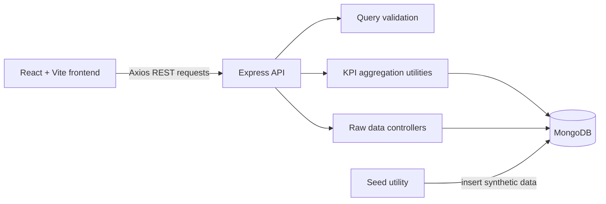
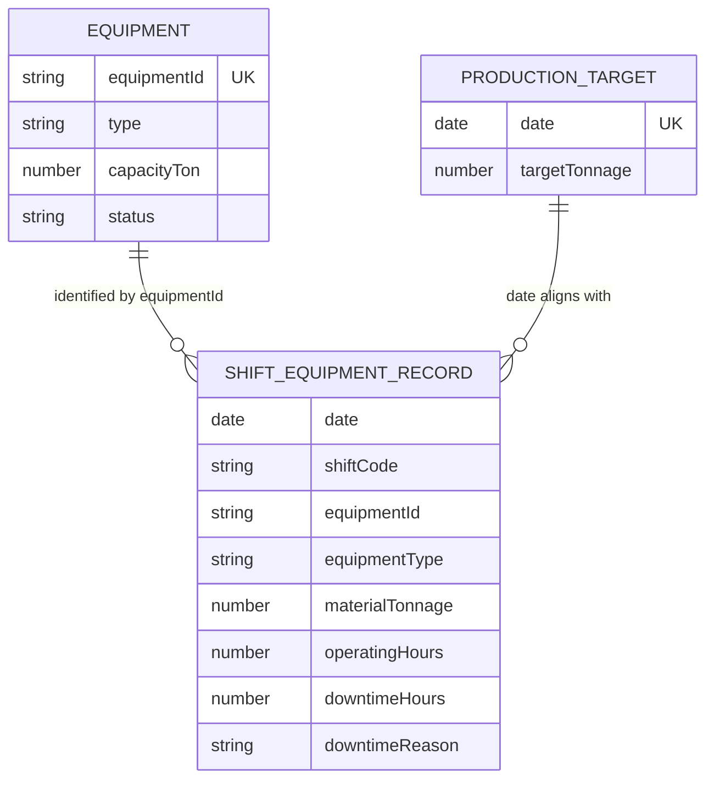

# Surface Mining Dashboard

A full-stack MERN dashboard for exploring synthetic surface-mine operations data. The application gives operations teams, analysts, and engineering interviewers a single view of production, equipment utilization, downtime, and target attainment across dates, shifts, and equipment types.

The project is contained in [`UGP/`](./). The backend exposes a REST API backed by MongoDB, while the frontend consumes that API to render interactive charts and operational tables.

## Key Features

- **KPI dashboard:** Displays total production, average daily production, utilization, downtime, and plan attainment.
- **Production analysis:** Compares daily actual production with daily production targets and summarizes production by shift.
- **Equipment utilization:** Aggregates operating and downtime hours per equipment unit and presents utilization rankings.
- **Downtime analysis:** Groups downtime hours by reason and surfaces the largest downtime drivers.
- **Operational filters:** The dashboard refetches KPI data when the date range, shift (`A`, `B`, or `C`), or equipment type changes.
- **Equipment and raw-data views:** Provides a utilization table and a bounded raw shift-record table for inspection.
- **Synthetic data generation:** Seeds a repeatable equipment fleet, shift records, and daily targets. The default dataset covers 21 days, three shifts per day, six dumpers, and three shovels.
- **Responsive presentation:** Uses Recharts visualizations, a responsive CSS layout, React Router navigation, and light/dark/system theme selection persisted in browser local storage.
- **API observability:** Includes `/api` and `/api/health` responses, Morgan request logging, CORS, and centralized Express error serialization.

## Technology Stack

| Area | Verified technologies |
| --- | --- |
| Frontend | React 19, React DOM, Vite, React Router, Axios, Recharts |
| UI | Plain CSS design tokens and responsive layout; `lucide-react`, `framer-motion`, and Tailwind are listed as dependencies but are not used by the inspected source |
| Backend | Node.js, Express 5, ES modules, Morgan |
| Database | MongoDB with Mongoose 9 |
| Configuration | `dotenv` environment loading |
| Data generation | Deterministic JavaScript seed utility |
| Validation | Application-level query validation for date ranges, shifts, and equipment types |
| Testing/build | Node syntax checks for selected backend files; Vite production build; frontend `test` script is a smoke-message placeholder |

## System Architecture



The frontend runs as a Vite development server and calls the backend through `VITE_API_BASE_URL`. The backend connects to MongoDB before listening for requests. KPI endpoints aggregate `ShiftEquipmentRecord` documents and combine actual production with `ProductionTarget` documents where applicable.

There are no verified authentication, authorization, caching, real-time transport, background worker, or external AI/ML integrations in the current implementation.

## Project Structure

```text
BTP/
├── README.md
└── UGP/
    ├── project_summary.md
    ├── backend/
    │   ├── package.json
    │   └── src/
    │       ├── app.js
    │       ├── server.js
    │       ├── config/db.js
    │       ├── controllers/
    │       │   ├── dataController.js
    │       │   └── kpiController.js
    │       ├── models/
    │       │   ├── Equipment.js
    │       │   ├── ProductionTarget.js
    │       │   └── ShiftEquipmentRecord.js
    │       ├── routes/
    │       │   ├── dataRoutes.js
    │       │   └── kpiRoutes.js
    │       └── utils/
    │           ├── kpiUtils.js
    │           ├── seedSampleData.js
    │           └── validators.js
    └── frontend/
        ├── package.json
        ├── index.html
        └── src/
            ├── App.jsx
            ├── main.jsx
            ├── style.css
            ├── components/
            │   ├── Dashboard/
            │   ├── Filters/
            │   ├── Layout/
            │   └── UI/
            ├── pages/
            │   ├── MainDashboard.jsx
            │   ├── EquipmentView.jsx
            │   └── DataView.jsx
            └── services/api.js
```

## Prerequisites

- Node.js and npm compatible with the versions declared in the installed package lockfiles. The project does not declare an `engines` field, so an exact Node.js version is not specified.
- A running MongoDB instance, local or hosted.
- Git.

## Installation and Local Setup

Clone the repository and enter the application directory:

```bash
git clone https://github.com/Niranjan05Kumar/BTP.git
cd BTP/UGP
```

### 1. Configure and start the backend

```bash
cd backend
copy .env.example .env
npm install
npm run seed:drop
npm run dev
```

On macOS/Linux, replace `copy .env.example .env` with `cp .env.example .env`.

The API listens on `http://localhost:5000` by default. `npm run seed:drop` connects to MongoDB and recreates the seeded equipment, shift records, and target collections. The seed utility currently clears and repopulates these collections on every run; use it only against the intended database.

### 2. Configure and start the frontend

In a second terminal:

```bash
cd BTP/UGP/frontend
copy .env.example .env
npm install
npm run dev
```

On macOS/Linux, replace the `copy` command with `cp`. Vite normally serves the frontend at `http://localhost:5173`.

If the backend uses a non-default URL, update `VITE_API_BASE_URL` before starting Vite. The frontend defaults to `http://localhost:5000/api` when the variable is absent.

### Available scripts

Backend (`UGP/backend`):

```bash
npm run dev       # nodemon development server
npm start         # production-style Node server
npm run seed      # reseed synthetic data
npm run seed:drop # clear and reseed synthetic data
npm test          # node --check on selected backend files
```

Frontend (`UGP/frontend`):

```bash
npm run dev       # Vite development server
npm run build     # production bundle
npm run preview   # serve the built bundle locally
npm test          # prints a configured smoke-test message
```

## Environment Variables

### Backend: `UGP/backend/.env`

```dotenv
PORT=5000
MONGO_URI=mongodb://localhost:27017
MONGO_DB_NAME=surface_mining_dashboard
SEED_DAYS=21
SEED_BASE=1337
```

| Variable | Purpose |
| --- | --- |
| `PORT` | HTTP port for the Express server. Defaults to `5000`. |
| `MONGO_URI` | MongoDB connection URI. Required; the server exits if it is missing. |
| `MONGO_DB_NAME` | Database name passed to Mongoose. Defaults to `surface_mining_dashboard`. |
| `SEED_DAYS` | Number of days generated by the seed utility. Defaults to `21`. |
| `SEED_BASE` | Numeric seed used for repeatable generated values. Defaults to `1337`. |

### Frontend: `UGP/frontend/.env`

```dotenv
VITE_API_BASE_URL=http://localhost:5000/api
```

`VITE_API_BASE_URL` is the Axios base URL used by the browser application. Do not place secrets in frontend environment variables because Vite exposes `VITE_*` values to client-side code.

## API Documentation

All routes below are relative to `http://localhost:5000`. KPI routes require `start` and `end` in a parseable `YYYY-MM-DD` form. Optional KPI filters are `shift=all|A|B|C` and `type=all|dumper|shovel|dozer|drill`. Invalid filters or a reversed date range return HTTP 400 with a JSON `message`.

### Service endpoints

| Method | Route | Purpose | Authentication |
| --- | --- | --- | --- |
| GET | `/api` | Returns API name and health route information | None |
| GET | `/api/health` | Returns `{ "status": "ok", "timestamp": "..." }` | None |

### KPI endpoints

| Method | Route | Purpose | Response shape |
| --- | --- | --- | --- |
| GET | `/api/kpi/summary` | Calculates production, average daily production, utilization, downtime, cost per tonne, plan attainment, and top downtime reasons | JSON object |
| GET | `/api/kpi/production/daily` | Groups actual material tonnage by date and adds the matching target | Array of `{ date, actual, target }` |
| GET | `/api/kpi/production/by-shift` | Groups material tonnage by shift code | Array of `{ shiftCode, production }` |
| GET | `/api/kpi/equipment/utilization` | Groups operating/downtime hours by equipment and calculates utilization | Array of equipment utilization objects |
| GET | `/api/kpi/downtime/by-reason` | Groups downtime hours by downtime reason | Array of `{ reason, downtimeHours }` |

Examples:

```text
GET /api/kpi/summary?start=2026-01-01&end=2026-01-21&shift=A&type=dumper
GET /api/kpi/production/daily?start=2026-01-01&end=2026-01-21
GET /api/kpi/equipment/utilization?start=2026-01-01&end=2026-01-21&type=shovel
```

### Raw data endpoints

| Method | Route | Purpose | Query behavior |
| --- | --- | --- | --- |
| GET | `/api/data/equipment` | Lists equipment definitions sorted by `equipmentId` | No query parameters |
| GET | `/api/data/records` | Lists shift/equipment fact records | Optional `start`, `end`, and `limit`; limit is capped at 1000 and defaults to 300 |
| GET | `/api/data/targets` | Lists production targets sorted by date | No query parameters |

The raw-record controller currently filters only by date range; `shift` and `type` values sent by the frontend are not applied to this endpoint.

Unexpected server/database errors are serialized as HTTP 500 JSON responses by the Express error middleware. No endpoint requires authentication in the current codebase.

## Database Design

MongoDB contains three Mongoose collections:

- **`Equipment`** — equipment identity, type, capacity, status, and notes. `equipmentId` is unique.
- **`ShiftEquipmentRecord`** — the main fact collection, with date, shift, equipment, material tonnage, trips, operating hours, downtime hours/reason, fuel, and operating cost. A compound index supports date/shift/equipment lookups.
- **`ProductionTarget`** — one target tonnage per date. `date` is unique and indexed.



The relationships shown are logical application relationships rather than Mongoose `ref` foreign keys. KPI calculations join targets by formatted date and group operational records through their stored equipment identifiers and types.

### KPI formulas

- **Average utilization:** `totalOperatingHours / (totalOperatingHours + totalDowntimeHours) * 100`
- **Equipment utilization:** `operatingHours / (numberOfRecords * 8) * 100`
- **Downtime percentage:** `totalDowntimeHours / (totalOperatingHours + totalDowntimeHours) * 100`
- **Plan attainment:** `totalProduction / totalTarget * 100`
- **Cost per tonne:** `totalOperatingCost / totalProduction`
- **Average daily production:** `totalProduction / numberOfReturnedProductionDays`

## Security and Error Handling

- Mongoose schemas enforce required fields, numeric minimums/maximums, enumerated shifts/equipment types, and unique indexes where defined.
- KPI query inputs are validated before aggregation, including required dates, valid date ordering, supported shift codes, and supported equipment types.
- Express uses `express.json()`, CORS, Morgan request logging, and centralized error middleware.
- The application has no implemented user authentication, authorization, rate limiting, password handling, or secret-management service. MongoDB credentials and other sensitive values must remain in local environment files.

## Testing and Build Verification

The repository currently contains no dedicated unit, integration, or end-to-end test files.

- `backend/npm test` runs `node --check` against `server.js`, `app.js`, and `kpiUtils.js`; it checks syntax only.
- `frontend/npm test` prints `Frontend smoke test script configured`; it does not execute assertions.
- `frontend/npm run build` creates the Vite production bundle.

These commands are configured in the package manifests; they were not treated as evidence of a full automated test suite.

## Deployment

No Dockerfile, Docker Compose file, CI workflow, hosting configuration, or verified production deployment is present in the inspected repository. A deployment would need:

1. A reachable MongoDB instance and securely configured `MONGO_URI`.
2. A backend process running `npm start`.
3. A built frontend from `npm run build`, served by a static host or web server.
4. A frontend `VITE_API_BASE_URL` pointing to the deployed API before the Vite build.

The production hosting provider, TLS configuration, domain, process manager, and CORS allowlist require deployment-specific decisions and are not defined by this project.

## Current Limitations

- Data is synthetic and generated locally; no external mine telemetry or third-party API integration is implemented.
- The frontend displays fixed “trend” values and random sparkline samples in KPI cards rather than calculating historical trend series.
- The dashboard’s “Export” control is presentational and has no export handler.
- Frontend Equipment and Data pages use their own fixed recent date ranges instead of the dashboard filter state.
- The raw-data route does not apply shift or equipment-type filtering.
- There are no authentication/authorization controls or automated application-level tests.
- The HTML document title remains `frontend` in `frontend/index.html`.

## Further Reading


- [`project_summary.md`](./project_summary.md) — original project scope and domain model.
- [`frontend/README_UI.md`](./frontend/README_UI.md) — UI redesign notes.
