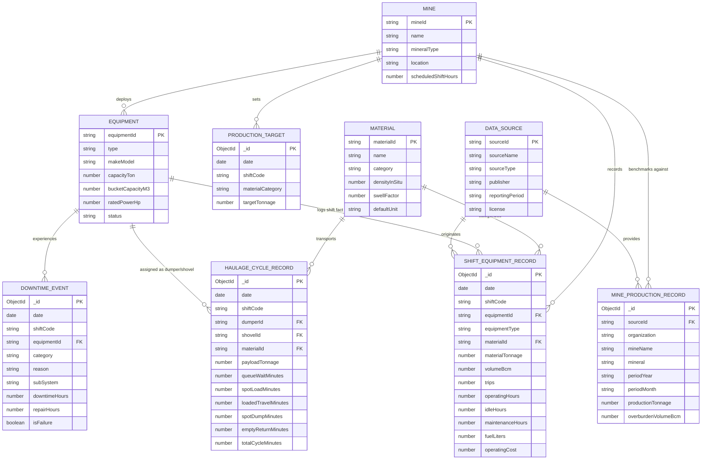

# Database Schema Design: Surface Mining Dashboard

**Project:** Development of a Web-based Production and Equipment Utilization Dashboard for Surface Mining Operations  
**Document Version:** 1.0  
**Phase:** Phase 1 — Requirements and Data Architecture  

---

## 1. Architectural Philosophy

The database architecture employs **MongoDB** with **Mongoose ODM**. It balances normalized relational integrity for fleet and material masters with performant, document-oriented fact storage for high-frequency shift and haulage events.

### Core Architectural Decisions:
1. **Dynamic KPI Calculation over Stored Aggregates:**
   - Analytical KPIs (Mechanical Availability, Utilization, Plan Attainment, Match Factor, MTBF, MTTR, Stripping Ratios) are computed on the fly using MongoDB aggregation pipelines and indexed ranges.
   - This prevents stale cache states, ensures filter agility across arbitrary date windows, and eliminates redundant summary collections.
2. **Strict Entity Separation:**
   - **Master Data:** Persistent static references for mines, fleet specifications, and materials.
   - **Operational Data:** Shift-level equipment performance, discrete haulage cycles, and granular downtime/repair event records.
   - **Reference Data:** Official public mining industry benchmark statistics.
3. **Hybrid Model Preservation:**
   - Existing collections (`Equipment`, `ShiftEquipmentRecord`, `ProductionTarget`) are extended cleanly rather than dropped, preserving backward compatibility with existing endpoints while adding missing mining attributes.

---

## 2. Entity-Relationship Diagram



---

## 3. Detailed Mongoose Schema Definitions

### 3.1 Master Data Collections

#### A. `Mine` (`mines`)
Represents the mining site or operational concession.
```javascript
import mongoose from "mongoose";

const mineSchema = new mongoose.Schema(
  {
    mineId: { type: String, required: true, unique: true, uppercase: true, trim: true },
    name: { type: String, required: true, trim: true },
    mineralType: { 
      type: String, 
      required: true, 
      enum: ["Coal", "Iron Ore", "Bauxite", "Limestone", "Copper", "Multi-Mineral"] 
    },
    location: {
      state: { type: String, required: true, trim: true },
      country: { type: String, default: "India", trim: true },
    },
    scheduledShiftHours: { type: Number, default: 8.0, min: 4, max: 12 },
    shiftsPerDay: { type: Number, default: 3, min: 1, max: 4 },
  },
  { timestamps: true }
);

mineSchema.index({ mineId: 1 });
export default mongoose.model("Mine", mineSchema);
```

#### B. `Material` (`materials`)
Defines the minerals and waste strata extracted, with physical rock-mechanics conversion factors.
```javascript
import mongoose from "mongoose";

const materialSchema = new mongoose.Schema(
  {
    materialId: { type: String, required: true, unique: true, uppercase: true, trim: true },
    name: { type: String, required: true, trim: true },
    category: { 
      type: String, 
      required: true, 
      enum: ["Ore", "Mineral", "Overburden", "Waste", "Topsoil"] 
    },
    densityInSitu: { type: Number, required: true, min: 0.5, max: 5.0 }, // tonnes per cubic meter (t/m³)
    swellFactor: { type: Number, required: true, min: 1.0, max: 2.0, default: 1.25 }, // Loose volume expansion
    defaultUnit: { type: String, default: "tonnes", enum: ["tonnes", "BCM"] },
  },
  { timestamps: true }
);

materialSchema.index({ materialId: 1, category: 1 });
export default mongoose.model("Material", materialSchema);
```

#### C. `Equipment` (`equipment`)
Extends the existing equipment master with engineering specifications necessary for matching, pass calculation, and fuel metrics.
```javascript
import mongoose from "mongoose";

const equipmentSchema = new mongoose.Schema(
  {
    equipmentId: { type: String, required: true, unique: true, uppercase: true, trim: true },
    type: {
      type: String,
      required: true,
      enum: [
        "dumper",
        "shovel",
        "wheel_loader",
        "dozer",
        "drill",
        "motor_grader",
        "water_tanker"
      ],
      index: true,
    },
    makeModel: { type: String, default: "", trim: true },
    capacityTon: { type: Number, required: true, min: 0 }, // Rated payload for dumpers, service weight for dozers
    bucketCapacityM3: { type: Number, default: 0, min: 0 }, // For shovels and wheel loaders
    ratedPowerHp: { type: Number, default: 0, min: 0 }, // Engine rating
    status: {
      type: String,
      required: true,
      default: "active",
      enum: ["active", "standby", "under_maintenance", "decommissioned"],
    },
    notes: { type: String, default: "", trim: true },
  },
  { timestamps: true }
);

equipmentSchema.index({ equipmentId: 1, type: 1, status: 1 });
export default mongoose.model("Equipment", equipmentSchema);
```

#### D. `DataSource` (`datasources`)
Tracks origin, provenance, and authenticity distinctions.
```javascript
import mongoose from "mongoose";

const dataSourceSchema = new mongoose.Schema(
  {
    sourceId: { type: String, required: true, unique: true, trim: true },
    sourceName: { type: String, required: true, trim: true },
    sourceType: { 
      type: String, 
      required: true, 
      enum: ["public_benchmark", "synthetic_simulation", "field_telemetry"] 
    },
    publisher: { type: String, default: "", trim: true },
    reportingPeriod: { type: String, default: "", trim: true },
    referenceUrl: { type: String, default: "", trim: true },
  },
  { timestamps: true }
);

export default mongoose.model("DataSource", dataSourceSchema);
```

---

### 3.2 Operational Data Collections

#### A. `ShiftEquipmentRecord` (`shiftequipmentrecords`)
The primary fact collection recording 8-hour shift summaries per equipment unit. Reconciles operating, idle, and maintenance hours to scheduled time ($8.0\text{ h}$).
```javascript
import mongoose from "mongoose";

const shiftEquipmentRecordSchema = new mongoose.Schema(
  {
    date: { type: Date, required: true, index: true },
    shiftCode: { type: String, required: true, enum: ["A", "B", "C"], index: true },
    equipmentId: { type: String, required: true, trim: true, index: true },
    equipmentType: {
      type: String,
      required: true,
      enum: [
        "dumper",
        "shovel",
        "wheel_loader",
        "dozer",
        "drill",
        "motor_grader",
        "water_tanker"
      ],
      index: true,
    },
    materialId: { type: String, default: "COAL", ref: "Material" },
    materialCategory: { 
      type: String, 
      default: "Mineral", 
      enum: ["Ore", "Mineral", "Overburden", "Waste", "Topsoil", "Support"] 
    },
    materialTonnage: { type: Number, required: true, min: 0, default: 0 },
    volumeBcm: { type: Number, default: 0, min: 0 },
    trips: { type: Number, required: true, min: 0, default: 0 },
    operatingHours: { type: Number, required: true, min: 0, max: 8, default: 0 },
    idleHours: { type: Number, required: true, min: 0, max: 8, default: 0 },
    maintenanceHours: { type: Number, required: true, min: 0, max: 8, default: 0 },
    primaryDowntimeReason: { type: String, default: "None", trim: true },
    fuelLiters: { type: Number, min: 0, default: 0 },
    operatingCost: { type: Number, min: 0, default: 0 },
    dataSource: { type: String, default: "synthetic_simulation" },
  },
  { timestamps: true }
);

// Compound indexes for performant query aggregation
shiftEquipmentRecordSchema.index({ date: 1, shiftCode: 1, equipmentType: 1 });
shiftEquipmentRecordSchema.index({ date: 1, equipmentId: 1 });
shiftEquipmentRecordSchema.index({ materialCategory: 1, date: 1 });

export default mongoose.model("ShiftEquipmentRecord", shiftEquipmentRecordSchema);
```

#### B. `HaulageCycleRecord` (`haulagecyclerecords`)
Captures detailed cycle-time phases for dumpers to empower Module D (Haulage Analysis) and Module E (Matching).
```javascript
import mongoose from "mongoose";

const haulageCycleRecordSchema = new mongoose.Schema(
  {
    date: { type: Date, required: true, index: true },
    shiftCode: { type: String, required: true, enum: ["A", "B", "C"], index: true },
    dumperId: { type: String, required: true, trim: true, index: true },
    shovelId: { type: String, required: true, trim: true, index: true },
    materialId: { type: String, required: true, ref: "Material" },
    payloadTonnage: { type: Number, required: true, min: 0 },
    queueWaitMinutes: { type: Number, required: true, min: 0, default: 0 },
    spotLoadMinutes: { type: Number, required: true, min: 0, default: 0 },
    loadedTravelMinutes: { type: Number, required: true, min: 0, default: 0 },
    spotDumpMinutes: { type: Number, required: true, min: 0, default: 0 },
    emptyReturnMinutes: { type: Number, required: true, min: 0, default: 0 },
    totalCycleMinutes: { type: Number, required: true, min: 0 },
  },
  { timestamps: true }
);

haulageCycleRecordSchema.index({ date: 1, shiftCode: 1, dumperId: 1 });
haulageCycleRecordSchema.index({ shovelId: 1, date: 1 });

export default mongoose.model("HaulageCycleRecord", haulageCycleRecordSchema);
```

#### C. `DowntimeEvent` (`downtimeevents`)
Records discrete equipment stoppage events to compute true MTBF and MTTR and Pareto classifications.
```javascript
import mongoose from "mongoose";

const downtimeEventSchema = new mongoose.Schema(
  {
    date: { type: Date, required: true, index: true },
    shiftCode: { type: String, required: true, enum: ["A", "B", "C"] },
    equipmentId: { type: String, required: true, trim: true, index: true },
    equipmentType: { type: String, required: true },
    category: {
      type: String,
      required: true,
      enum: ["Planned Maintenance", "Unplanned Breakdown", "Operational Delay"],
      index: true,
    },
    subSystem: {
      type: String,
      default: "General",
      enum: [
        "Engine",
        "Hydraulics",
        "Transmission",
        "Electrical",
        "Tires & Tracks",
        "Structural",
        "Operational",
        "Weather",
        "General"
      ],
    },
    reason: { type: String, required: true, trim: true },
    downtimeHours: { type: Number, required: true, min: 0.1, max: 24 },
    repairHours: { type: Number, default: 0, min: 0, max: 24 }, // Active mechanic wrench time
    isFailure: { type: Boolean, required: true, default: false }, // Qualifying event for MTBF
  },
  { timestamps: true }
);

downtimeEventSchema.index({ equipmentId: 1, date: 1, isFailure: 1 });
downtimeEventSchema.index({ category: 1, date: 1 });

export default mongoose.model("DowntimeEvent", downtimeEventSchema);
```

#### D. `ProductionTarget` (`productiontargets`)
Supports date-level and shift-level targets by material category.
```javascript
import mongoose from "mongoose";

const productionTargetSchema = new mongoose.Schema(
  {
    date: { type: Date, required: true, index: true },
    shiftCode: { type: String, enum: ["A", "B", "C", "ALL"], default: "ALL" },
    materialCategory: { 
      type: String, 
      enum: ["Mineral", "Overburden", "Total"], 
      default: "Total" 
    },
    targetTonnage: { type: Number, required: true, min: 0 },
  },
  { timestamps: true }
);

productionTargetSchema.index({ date: 1, shiftCode: 1, materialCategory: 1 }, { unique: true });
export default mongoose.model("ProductionTarget", productionTargetSchema);
```

---

### 3.3 Reference Benchmark Collection

#### `MineProductionRecord` (`mineproductionrecords`)
Stores authentic Indian public sector mining performance records (e.g., CIL open-cast mines) to benchmark against simulated metrics.
```javascript
import mongoose from "mongoose";

const mineProductionRecordSchema = new mongoose.Schema(
  {
    sourceId: { type: String, required: true, ref: "DataSource" },
    organization: { type: String, required: true, trim: true }, // e.g. "Coal India Limited (NCL)"
    mineName: { type: String, required: true, trim: true }, // e.g. "Jayant Opencast Mine"
    mineral: { type: String, required: true, trim: true }, // e.g. "Coal"
    fiscalYear: { type: String, required: true }, // e.g. "2023-24"
    reportingMonth: { type: String, required: true }, // e.g. "October 2023"
    productionTonnage: { type: Number, required: true, min: 0 },
    overburdenVolumeBcm: { type: Number, min: 0, default: 0 },
    strippingRatio: { type: Number, min: 0, default: 0 },
    averageAvailabilityPercent: { type: Number, min: 0, max: 100 },
    averageUtilizationPercent: { type: Number, min: 0, max: 100 },
  },
  { timestamps: true }
);

mineProductionRecordSchema.index({ organization: 1, mineName: 1, fiscalYear: 1 });
export default mongoose.model("MineProductionRecord", mineProductionRecordSchema);
```

---

## 4. Indexing & Optimization Strategy

1. **Date-Range Slicing:**
   - Every operational collection has an index on `date: 1` as the leading key to guarantee that queries bounding `startDate` and `endDate` use index range scans rather than full collection scans.
2. **Filter Composition:**
   - Compound indexes `{ date: 1, shiftCode: 1, equipmentType: 1 }` support combined UI filter states without in-memory sorting or filtering.
3. **Foreign Key Integrity:**
   - Logical references (`equipmentId`, `materialId`) are indexed on fact tables to ensure rapid lookups and joins in aggregation pipelines.

---

*Validated for execution on MongoDB 7+ and Mongoose 9.*

