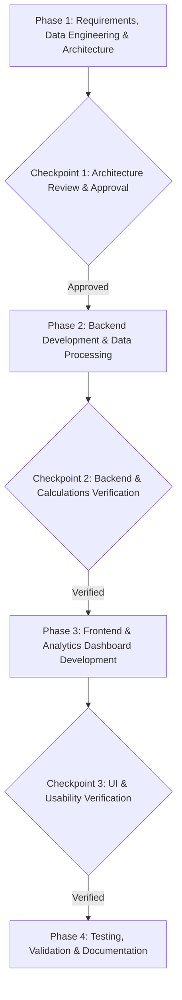

# Phase 1 Implementation Plan & Four-Phase Roadmap

**Project:** Development of a Web-based Production and Equipment Utilization Dashboard for Surface Mining Operations  
**Document Version:** 1.0  
**Phase:** Phase 1 — Roadmap & Governance  

---

## 1. Project Phase Overview

---

## 2. Phase-by-Phase Roadmap

### PHASE 1 — REQUIREMENTS, AUDIT & DATA ENGINEERING (Current Phase)
- **Status:** **Completed (Documentation Ready for Review)**
- **Primary Deliverables:**
  1. [`docs/PROJECT_AUDIT.md`](./PROJECT_AUDIT.md) — Comprehensive source audit & gap analysis.
  2. [`docs/FEATURE_SPECIFICATION.md`](./FEATURE_SPECIFICATION.md) — Exhaustive specification for Modules A–K.
  3. [`docs/DATABASE_SCHEMA.md`](./DATABASE_SCHEMA.md) — Normalized Mongoose models, collections, indexes.
  4. [`docs/DATA_DICTIONARY.md`](./DATA_DICTIONARY.md) — Attribute-level field descriptions and units.
  5. [`docs/KPI_DEFINITIONS.md`](./KPI_DEFINITIONS.md) — Mining engineering equations and boundary rules.
  6. [`docs/DATA_SOURCE_REGISTER.md`](./DATA_SOURCE_REGISTER.md) — Public benchmarks & 30-day simulation model.
  7. [`docs/PHASE_1_PLAN.md`](./PHASE_1_PLAN.md) — Multi-phase execution schedule and risk register.
- **Checkpoint:** No code changes made to backend or frontend until architecture approval is granted.

---

### PHASE 2 — BACKEND DEVELOPMENT & ADVANCED DATA PROCESSING
- **Objective:** Build backend schemas, services, realistic 30-day data generator, and high-performance aggregation endpoints.
- **Work Breakdown:**
  1. **Schema Extension & Migration:**
     - Update `Equipment.js` with power, bucket capacity, and expanded types.
     - Add `Material.js`, `Mine.js`, `DataSource.js` master models.
     - Enhance `ShiftEquipmentRecord.js` with idle hours, maintenance hours, material references, and volume BCM.
     - Create `HaulageCycleRecord.js`, `DowntimeEvent.js`, and `MineProductionRecord.js`.
  2. **Deterministic 30-Day Seed Generator:**
     - Implement physics-based, 30-day simulation covering 15 equipment units across 3 shifts.
     - Generate discrete cycle records (queue, load, haul, dump, return).
     - Populate breakdown events aligning with shift downtime.
     - Seed authentic public reference records (CIL, IBM, DGMS).
  3. **Analytical Controllers & Service Utilities:**
     - `kpiUtils.js` expansion: Fix production double-counting and shift-scaling attainment.
     - Implement Mechanical Availability ($MA$), Utilization ($OU$), Use of Availability ($UA$).
     - Implement Haulage cycle analytics ($T_c$, queue ratio, productivity).
     - Implement Shovel-Dumper Match Factor ($MF$) and pass counts.
     - Implement Stripping ratio ($SR_v$ in $\text{m}^3/\text{t}$, $SR_m$ in $\text{t/t}$).
     - Implement MTBF and MTTR reliability aggregation.
     - Implement explainable heuristic insights engine.
  4. **API Route Architecture:**
     - Mount modular routes: `/api/production`, `/api/equipment`, `/api/downtime`, `/api/haulage`, `/api/fleet`, `/api/materials`, `/api/reliability`, `/api/insights`, `/api/benchmarks`.
     - Standardize JSON response envelops and query validation.
  5. **Verification:**
     - Add Node-based automated calculation verification tests for all KPI formulas.

---

### PHASE 3 — FRONTEND & ANALYTICAL DASHBOARD DEVELOPMENT
- **Objective:** Transform the UI into a modular, responsive 12-page industrial mining analytics suite using React and Recharts.
- **Work Breakdown:**
  1. **Layout & Navigation Architecture:**
     - Upgrade `TopNav.jsx` and routing to support 12 specialized pages/views.
     - Implement responsive sidebar or categorized navigation tabs.
     - Implement synchronized global filter bar (Date range, Shift, Equipment Type, Material) shared across all views.
  2. **Page Implementations:**
     - **Page 1: Executive Dashboard Overview** (Real KPI cards with true trends, summary charts, live bottleneck alerts).
     - **Page 2: Production Analysis** (Daily tonnage, shift distribution, target attainment, cumulative trends).
     - **Page 3: Equipment Fleet Performance** (Availability vs Utilization scatter/bar, hours breakdown, productivity).
     - **Page 4: Downtime & Delay Analysis** (Pareto reasons, planned vs unplanned breakdown, shift distribution).
     - **Page 5: Haulage Cycle-Time Analysis** (5-phase cycle stacked bar, queue ratio, haul speed/transit efficiency).
     - **Page 6: Shovel-Dumper Matching Analysis** (Match Factor gauges, pass-load matrix, over/under-trucked alerts).
     - **Page 7: Material & Stripping-Ratio Analysis** (Coal vs OB breakdown, Volumetric $SR_v$ trend, BCM volume).
     - **Page 8: Fuel & Cost Efficiency** (L/hr, L/t, specific cost per tonne, fleet cost comparison).
     - **Page 9: Equipment Reliability (MTBF / MTTR)** (Failure frequency, MTBF trend, repair duration, sub-system Pareto).
     - **Page 10: Operational Bottleneck Insights** (Explainable, rule-based diagnostic cards with action suggestions).
     - **Page 11: Fleet Master & Equipment Management** (Detailed equipment roster, specifications, status cards).
     - **Page 12: Raw Operational Logs & Reference Benchmarks** (Searchable, paginated shift records, public benchmark table, CSV export).
  3. **Data Integrity & UX Cleanup:**
     - Eliminate all `Math.random()` sparklines and hardcoded trend percentages.
     - Connect working CSV export utility on all analytical tables.
     - Maintain dark/light theme fidelity with high-contrast accessibility.

---

### PHASE 4 — TESTING, VALIDATION & TECHNICAL REPORT
- **Objective:** Comprehensive testing, calculation verification, and academic documentation.
- **Work Breakdown:**
  1. **Calculation Verification Suite:**
     - Automated test script verifying mathematical formulas against sample manual datasets:
       - Availability & Utilization equations.
       - Stripping ratio units ($m^3/t$ vs $t/t$).
       - Match factor arithmetic.
       - MTBF/MTTR failure isolation.
  2. **End-to-End System Testing:**
     - Test all API endpoints across edge conditions (empty date ranges, single-shift filters, zero-production days).
     - Verify database compound indexes and query performance.
     - Test frontend responsive layouts (desktop, tablet, mobile).
  3. **Deliverables & Report Material:**
     - Updated project README with complete setup instructions.
     - Complete BTP project documentation bundle for academic presentation.

---

## 3. Risk Register & Mitigation Strategy

| Risk ID | Description | Severity | Impact | Mitigation Strategy |
| :--- | :--- | :---: | :--- | :--- |
| **R-01** | Production Double-Counting | High | Distorts mine output by ~100% | Enforce dumper delivery as sole primary production measure in `kpiUtils`. |
| **R-02** | Target Attainment Under Partial Filters | Med | Shows false deficit (~33%) on shift filter | Apply shift-weight prorating formula ($w_s = 1/3$) when filtering by shift. |
| **R-03** | Division by Zero in KPIs | Med | Crashes calculations or returns `NaN` | Safe-division helper utilities in all aggregation pipelines (`$cond` / fallback guards). |
| **R-04** | Performance on Large Fact Collections | Med | Slow response on 30-day multi-equipment queries | Compound indexes on `(date, shiftCode, equipmentType)` and `(date, equipmentId)`. |
| **R-05** | Public vs Synthetic Data Confusion | High | Violates academic integrity | Prominent visual badges and distinct collections for benchmark data vs simulation. |

---

## 4. Key Review Decisions for Approval

Before proceeding to Phase 2, please confirm:
1. **Fleet Composition:** Approval of the 15-unit fleet (3 shovels, 1 loader, 7 dumpers, 2 dozers, 1 drill, 1 grader, 1 water tanker).
2. **Primary Production Boundary:** Agreement to count Dumper Delivery tonnage as net mine production to eliminate double counting.
3. **Database Entity Structure:** Approval to add `Material`, `Mine`, `DataSource`, `HaulageCycleRecord`, `DowntimeEvent`, and `MineProductionRecord`.
4. **Target Attainment Scaling:** Approval to scale 24-hr production targets by $1/3$ when filtering by a single 8-hour shift.

---

*Phase 1 documentation is complete and archived under `docs/`.*

